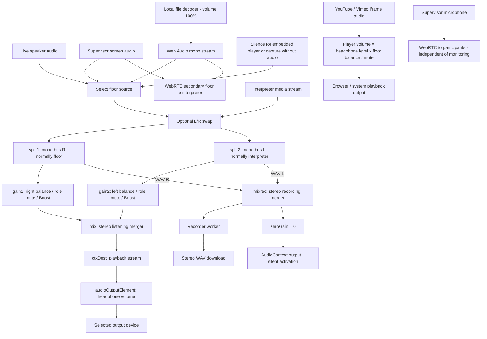

# InTrain 1.0 stabilization branch

This branch starts from the deployed InTrain files supplied in November 2026, not from the older `master` application sources. It preserves the existing three roles, PeerJS full-mesh topology, stereo monitoring and WAV recording, video-player controls, and current screen-sharing implementation.

## Deployment configuration

`config/config.js.dist` is the versioned, anonymous PeerJS/STUN/TURN configuration template. To deploy, copy it to `config/config.js` and configure the PeerJS server and the TURN servers/credentials. All four HTML pages load **`config/config.js`**, which is ignored by Git (`.gitignore`); the template is not loaded directly by browsers.

```sh
cp config/config.js.dist config/config.js
# Edit config/config.js with actual PeerJS and TURN settings.
```

If upgrading a deployment that already has a customized `js/config.js`, move that file to `config/config.js` instead, preserving its configuration values. **Never commit real TURN credentials to this public repository.** The configuration loaded in the browser is inherently visible to clients, regardless of Git ignore rules.

## Corrections

- Close PeerJS media/data connections regardless of whether their `open` getter is an own property; avoid hanging on close events and recursive cleanup.
- Reject unknown or conflicting incoming media connections, including unauthorized screen-share calls.
- Prevent a failed camera/microphone selection from stopping the working capture; await outgoing track replacements and preserve the user's muted state.
- Stop the previous Web Audio VU meter graph and animation when capture changes, without closing the shared AudioContext.
- Correct automatic speaker reconnection after role switching.
- Correct desktop-only audio capture for the speaker; clean up screen-sharing video and media connections when stopped from the browser or the application.
- Avoid inheriting a disabled camera's video mute state when sharing a screen.
- Send the current training/briefing mode and recording indicator when a late participant connects.
- Keep an ongoing supervisor screen share visible while speaker media joins, disconnects or reconnects; resend the current share when the interpreter reconnects, without replacing it with the speaker camera.
- Escape incoming chat messages and file names before inserting them into HTML.

## Verification

Run `node --test tests/smoke.test.js` for the dependency-free regression tests
and `node tests/local-floor-browser.cjs` for real Chrome media/WebRTC/WAV checks.
The browser test uses the supervisor's actual mono buses and recording graph,
checks a right-only stereo screen source and WAV channel swapping, and records
with headphone volume at zero. The unit tests additionally cover iframe volume
composition, mutes after Swap and WAV-export locking. Syntax-check the unminified
`js/*.js` files with `node --check`. These checks **do not** replace testing real
devices, external iframe services, multiple browsers or TURN/ICE.

Suggested manual acceptance test: connect supervisor, speaker and interpreter; verify briefing/training audio routing, stereo balance, recorder output with separate L/R channels, role switching, late joining, reconnection, camera/microphone device changes, and screen sharing (with and without desktop audio, including stopping from the browser UI). In particular, test speaker joining while supervisor screen sharing is active, interpreter reconnecting to an active share, and restoration of speaker video when sharing ends.

### Speaker screen sharing

The speaker's screen share replaces the existing outgoing webcam video track
on both speaker media calls, without opening a separate call. Audio is mixed
locally from the microphone plus any desktop/tab audio actually captured by the
browser. If desktop audio is unavailable, the microphone still works.
Microphone mute affects only the voice contribution, not the desktop audio;
the camera button always controls the webcam, never the screen.

The microphone/camera capture is retained while sharing. Track replacements
are awaited and rolled back if publication fails. Canceling the native picker
keeps the previous floor. The preview is not mirrored. Stopping via the button
or browser, disconnecting or leaving the page restores camera video and releases
desktop tracks, audio nodes and synthetic tracks. Camera/microphone device
selection remains blocked during sharing.

Manual test: three peers, switch camera/screen and back; capture tab audio with
microphone, and no-desktop-audio capture; mute and unmute the microphone; turn
off the camera while the screen is live; test native Stop Sharing, cancel, peers
reconnecting, disconnect and the supervisor's WAV recording of the mixed floor.
Screen audio availability varies with browser, OS and capture source.

## Code maintenance

The application still uses its existing PeerJS mesh topology and separate role pages.
The signaling topology and three-role model remain unchanged; maintenance fixes
source selection, monitoring and recording without introducing tandem roles.

- Bootstrap 5.3.9 replaces Bootstrap 4.6.1. The Bootstrap bundle provides Popper;
  `js/bootstrap-ui.js` exposes explicit native APIs for modals, tooltips and popovers.
  Bootstrap 5 markup and RTL-aware spacing classes replace Bootstrap 4 attributes.
- Inline application JavaScript was moved into readable, unminified scripts:
  `js/role-index.js`, `js/role-supervisor.js`, `js/role-speaker.js`,
  and `js/role-interpreter.js`. Shared logic stays in its existing files.
- `js/storage.js` saves persistent browser preferences under `intrain.*` in
  `localStorage`. The first read migrates the corresponding old cookie and expires
  it; no new preference cookies are written. The live session mode remains
  supervisor-controlled and is deliberately **not** restored from browser storage.
- The obsolete Bootstrap 4 input clearer is replaced by the readable
  `js/input-clearer.js`. Existing third-party prebuilt libraries, such as the
  bundled PeerJS client, are not rewritten or minified as part of this change.
- Removed abandoned commented-out implementation blocks. Explanatory comments,
  including the updated audio graph and the original language of comments, remain.

## Manual UI validation after Bootstrap 5 migration

Check all four pages: splash screen, popovers, tooltips, device selectors,
login and configuration dialogs, briefing/training buttons, debug-log collapse,
role-switch dialog, screen-share controls and responsive sizing. Then repeat a
three-peer exercise with recording and device switching. Automated unit tests
cannot verify visual layout or browser-specific WebRTC behavior.


## Supervisor audio routing

The default channel order is **interpreter on L, selected floor on R**, in both
headphones and the stereo WAV. Swap L/R exchanges those two sources before
monitoring and recording. Older comments saying the opposite were incorrect.
`channel1` starts as floor and `channel2` as interpreter; `split1` and `split2`
are legacy names for the **mono tap buses**, not channel splitters anymore.
Stereo sources are downmixed before the tap, preserving both stereo sides.



The iframe branch is separate: cross-origin player audio cannot be tapped by
this graph. Its volume follows the same headphone control, multiplied by its
floor balance and mute state. It retains its own stereo image; it cannot be
isolated onto a single physical L/R channel by InTrain. Device selection through
`audioOutputElement.setSinkId()` applies to the native mixed output, not to an
external iframe. If separate iframe output/device control or recording of the
video audio is essential, use Screen share with audio capture when available.

### Floor and recording sources

| Floor | Native floor bus / WAV floor channel | Supervisor listens to | Interpreter receives |
| --- | --- | --- | --- |
| Speaker | Live speaker, downmixed to mono | Floor + interpreter, separate L/R | Speaker media directly |
| Screen share | Captured audio; silence if absent | Shared audio + interpreter, separate L/R | Secondary WebRTC floor |
| Multimedia file | Decoded file audio; silence for a silent/unsupported audio track | File + interpreter, separate L/R | Secondary WebRTC floor |
| YouTube / Vimeo | Digital silence | Independent iframe player + interpreter | Synchronized local iframe player |

Each participant's missing input currently uses the existing very low-level
Brownian-noise fallback. It can also be present in the corresponding recorded
channel while that participant is absent. This is separate from the explicit
silence used for an audio-less capture or embedded floor.

### What the supervisor controls change

| Control | Local monitoring | WAV | Media sent to participants |
| --- | --- | --- | --- |
| Headphone volume | Final mixed output and iframe output level | Unchanged | Unchanged |
| Crossfader | Equal-power balance between physical L/R; iframe follows floor side | Unchanged | Unchanged |
| Remote participant mute | Mutes the selected participant/floor locally, even after Swap | Unchanged | Unchanged |
| Boost | Twice the normal native monitor gain; no amplification of iframe output | Unchanged | Unchanged |
| Swap L/R | Exchanges floor/interpreter channel placement | Exchanges WAV channel placement | Unchanged |
| Floor selector | Selects the floor source and replaces the old secondary floor | Changes the floor input without recreating Recorder | Changes the interpreter's floor |
| Briefing / Training | Sends session-mode instructions and toggles the supervisor mic | Recorder continues using its own taps | Supervisor mic is enabled/disabled; participant mode changes |

Microphone capture is independent: headphone volume, monitoring mutes, balance
and Boost never alter outgoing tracks. Stereo WAV is tapped **before** those
listening controls, so muting headphones does not mute the recording. The
supervisor mic is not part of the WAV. Notifications follow headphone volume but
are not routed into the recording. Using headphones avoids acoustic leakage
from playback back into a live microphone.

Stopping a recording requests WAV export immediately. Record stays disabled and
Save remains unavailable until the worker has finished and the new download
link is ready, protecting the last take against a rapid restart.

## Floor selector (supervisor)

The toolbar now has one compact **Select floor...** dropdown. It offers
**Speaker** (default), **Screen share...**, **YouTube / Vimeo...** and
**Multimedia file...**, preceded by the Material Symbol `interpreter_mode`.
The disabled placeholder displays the active floor and resets after selection
so YouTube/Vimeo or Multimedia file can be chosen again to replace the source.
When the speaker is absent, the Speaker option reads **Speaker (not connected)**
but remains selectable; its label updates automatically upon joining or leaving.

All four modes share one `selectSupervisorFloor()` entry point.
Speaker restores the normal camera/audio floor and stops any previous screen
share or embedded video after confirmation. Screen share uses the browser's
native capture picker and only stops the previous player if capture succeeds.
YouTube/Vimeo opens a small URL dialog. Canceling or submitting an invalid URL
does not interrupt an active floor; loading a valid video ends any live screen
capture. Both switching dialogs can be canceled.

The stereo recorder tracks the selected floor: interpreter plus speaker, screen
audio, local file audio, or silence for YouTube/Vimeo, with no need to restart
the recording.

### Local audio/video floor

Multimedia file opens the browser's file picker for a local audio or video file.
It is decoded locally and sent to the interpreter over the existing secondary
WebRTC media call, without uploading or sending the original file. The file
opens paused, with native playback/seek controls in the supervisor's main floor
area. The interpreter receives the same media there, without playback controls.
Only the interpreter receives this secondary floor, as with supervisor screen
sharing; the speaker interface is unchanged.

Canceling the picker, an unsupported file, or a decoding error during loading
leaves the previous floor running. Only a successfully prepared file takes over.
The floor menu can be used again to choose another file. A newer selection
invalidates pending loads. Returning to Speaker requires confirmation; opening
the screen picker keeps the file active until capture succeeds.

`js/local-floor.js` owns the media element and its resources. Web Audio downmixes
the file to mono for the single floor channel, including both sides of stereo
files. This stream feeds both the supervisor's crossfader and the recording
input; it never plays a second copy directly to the speakers. A canvas sends
video frames at the source cadence, scaled within 1280x720, and periodically
refreshes the paused frame for late joiners. Audio-only files have no video
track. Silent videos send silence on the floor audio channel. Pausing or reaching
EOF retains live tracks, so seeking/replay does not require a new connection or
recorder. Leaving the file floor releases tracks, nodes and the object URL.

Browser verification: `node tests/local-floor-browser.cjs` launches headless
Chrome (set `CHROME_PATH` to override its path). It checks real local decoding,
right-only stereo audio downmix, silence while paused, EOF/replay, WebRTC video
including joining while paused, invalid files, resource cleanup, and a WAV
encoded by InTrain's real recorder with separate interpreter/file tones on the
two channels. The test has no npm dependencies and runs in GitHub Actions.
Chrome is verified; other browsers and codecs still require manual checks.

Chromium can play video while silently skipping unsupported audio codecs. The
supervisor now receives a warning when the native decoded-audio byte counter
remains zero after three seconds of actual playback, or at EOF for shorter
files. Paused playback and headphone mute do not trigger it. This is a diagnostic
notice, not a codec identification: a file with no audio produces the same
notice. Browsers without this native counter cannot provide this diagnostic.
The warning suggests playing the file in a compatible external player and using
Screen share, including audio when supported for the selected capture source.
A version with AAC audio is offered as another option.
If audio decoding subsequently starts, a recovery message is logged. InTrain's
synthetic outgoing audio track is deliberately not used to infer file audio
support, since that track is present even for silent files.

Manual verification: select each floor, reselect YouTube/Vimeo to load another
video or multimedia file, cancel the URL dialog and browser capture/file picker, end the system screen
share from the browser UI, confirm return to Speaker, and inspect both WAV
channels when changing floor during a recording.

## Synchronized external videos

The supervisor controls the YouTube/Vimeo/Facebook player and sends `loadvideo`,
`playvideo`, `pausevideo` and `seekvideo` over the existing PeerJS data channel.
A late-joining interpreter also receives a `playerstate` snapshot with the current
URL, visibility, playback position and playing/paused state. Speakers do not
receive the video player, by design.

The interpreter's MediaElement player has no local playback controls. Mouse
interactions with the renderer (including YouTube/Vimeo iframes) are blocked by a
transparent overlay; MediaElement keyboard and click-to-play behavior are off.
The permanent headphone slider in the header controls this viewer's playback
volume, including the embedded video. It does not control the supervisor or
send volume commands to other peers.
Programmatic playback from the supervisor is unaffected, subject to browser
autoplay policies.

YouTube's `cc_load_policy` can force captions *on* but has no documented setting
that reliably forces them *off*. The application cannot guarantee that YouTube
will hide captions, since the default may follow the viewer's account settings.
Burned-in subtitles are part of the video and cannot be removed.

The video URL field accepts **complete HTTPS URLs only**, with supported YouTube,
Vimeo and Facebook video paths. Bare video IDs, general webpages and malformed
links are rejected before transmission. MediaElement errors are reported when
available; a URL cannot be guaranteed to refer to an existing or embeddable
video without checking the external video service. MediaElement.js remains at
version 4.2.7 during stabilization; upgrading to the 7.x series requires its
own compatibility test, particularly for third-party iframe renderers.

### External video synchronization (supervisor/interpreter)

YouTube and Vimeo playback use independent streams. InTrain therefore cannot
guarantee frame-accurate start, but it now waits for a `syncprepare` /
`syncready` exchange before sending `syncstart`. Each preparation has a
monotonically increasing epoch; stale replies and old connections are ignored.
A 12-second preparation timeout leaves playback paused rather than starting
unsynchronized. If the browser prevents remote autoplay, its warning is logged.

During uninterrupted playback the interpreter reports its player position
roughly every second. A small data-channel ping estimates network delay. The
supervisor displays a persistent warning after three reports with at least
one second of lag (or buffering). These reports **never** trigger automatic
seeks or playback changes on the interpreter.

When the supervisor pauses and later resumes, the interpreter first pauses and
reports its actual position. The **supervisor** seeks to that position before
both resume; the interpreting student never skips over an unheard passage.
A new or reconnecting interpreter instead seeks to the supervisor's current
paused position. If the supervisor was playing at reconnection, playback is
paused automatically and resumes only after the new interpreter reports ready.
If the interpreter cannot reach that position, both remain paused.

Manual checks: verify video load while disconnected, first Play with both
participants, pause/resume after letting one player lag, reconnect mid-play,
failed or private video timeout, and warning disappearance when lag clears.
YouTube/Vimeo may report readiness before network buffering has fully
stabilized, so the two streams can still begin at slightly different moments.

Manual checks: play/pause/seek on the supervisor, verify interpreter follows
without local control, reconnect the interpreter while a video is playing or
paused, try a valid-looking nonexistent ID, and verify the control group's
vertical alignment with the rest of the toolbar.

## Headphone volume (all roles)

Each role has one permanent 0-100% headphone slider in the top-right header,
immediately before Setup. `js/headphones.js` remembers this browser preference
under `headphone-volume`, so it survives role changes. Zero silences local
listening; existing participant mute settings and session controls are unchanged.

The control attenuates native remote media elements, the supervisor's final
mixed audio output and local notification sounds. For the interpreter and
supervisor, it also sets the embedded YouTube/Vimeo player's volume via
MediaElement, reapplied when an iframe renderer becomes ready or loads a new
source. The old interpreter-only video slider and the supervisor embedded
player's separate volume control have been removed.

Capture elements and the local multimedia decoder are excluded. The stereo
recorder still taps the mono buses before the final playback element,
and outgoing media tracks are untouched. The browser regression test records
separate interpreter/file tones with headphone volume at zero and checks both
WAV channels still contain their original signals.

## Acceptance checklist before replacing the principal branch

All changes remain on `1.0` until the following manual checks pass. Tandem,
booth-mate sessions and a supervisor who also interprets remain future work.

- [ ] Three separate participants: briefing permits conversation; training lets
  the interpreter hear only the active floor and keeps interpreter audio off
  the speaker's monitoring. Return to briefing, including during iframe playback.
- [ ] All four floor choices: speaker, screen (with/without audio), local audio
  and video, and real YouTube/Vimeo links. Cancellation/unsupported files leave
  the previous floor active. Browser Stop Sharing restores the speaker.
- [ ] Headphone volume at 0/50/100% for every role and every floor. Move the
  supervisor crossfader afterwards: zero must remain silent. Check actual audio
  output devices; iframe output follows the browser/system path separately.
- [ ] Supervisor balance, mutes, Boost and Swap L/R, including mute after Swap.
  Use headphones and a stereo source with sound only on its right channel.
- [ ] Record while changing floors and monitoring controls; inspect WAV L/R and
  Swap. Confirm that iframe video audio is absent by design. Stop/restart takes
  and download each finished WAV; test a realistically long exercise too.
- [ ] Local audio/video: pause, seek, EOF, replay, another file, unsupported audio,
  interpreter joining while paused and reconnecting during playback.
- [ ] YouTube/Vimeo: load, play, pause, seek, lag warning, unavailable/private
  video, autoplay permission, late join and reconnection. No forced skips during
  normal monitoring; resuming follows the interpreter's position.
- [ ] Swap speaker/interpreter roles in briefing, reconnect/disconnect both,
  reconnect an interpreter to a running shared/file floor, and close all tabs.
- [ ] Camera/mic/output changes and device unplug/replug; speaker-owned screen
  sharing and return to camera, including a participant joining during sharing.
- [ ] Actual target browser/OS combinations and a network that requires TURN.
  Verify audio-sharing availability for the selected tab/window/screen.
- [ ] Responsive header/toolbar, setup dialogs, chat/file transfer, recording
  indicator, timer and fullscreen controls.

Known limits are browser/codec/audio-capture support, non-frame-accurate iframe
synchronization, iframe audio excluded from WAV and separate iframe device
routing, in-memory recording size, and the existing anonymous session model.
No automatic checks certify a three-computer classroom deployment. After this
checklist passes, review the intended default/principal branch and the deployment
configuration before merging; this work does not change that branch.
